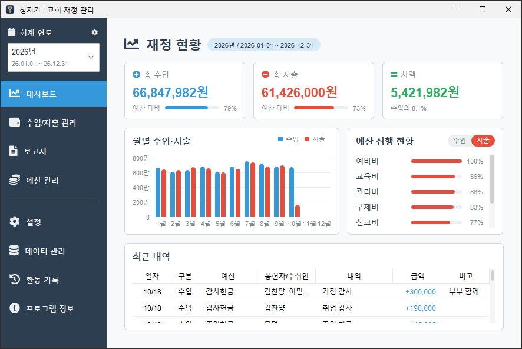
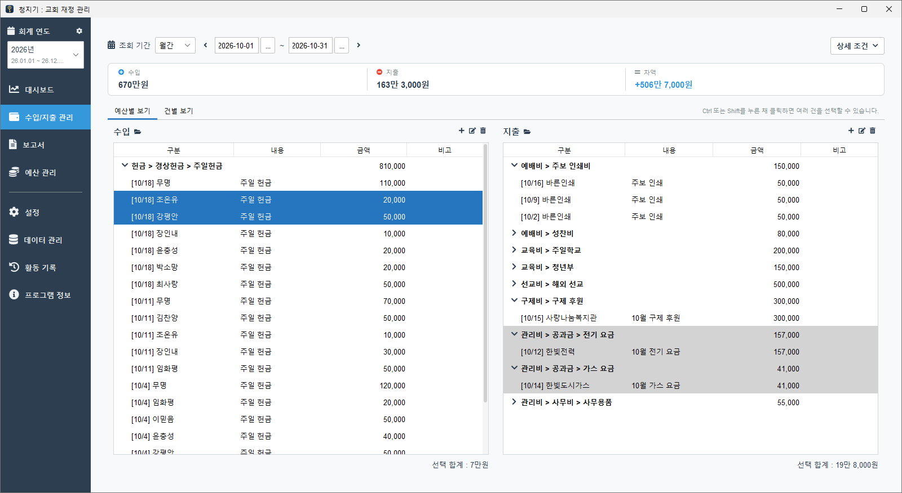
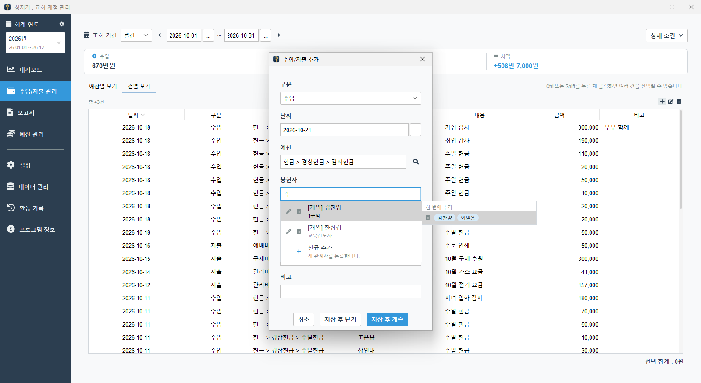
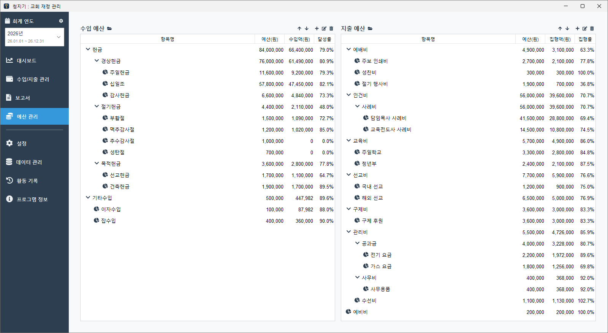
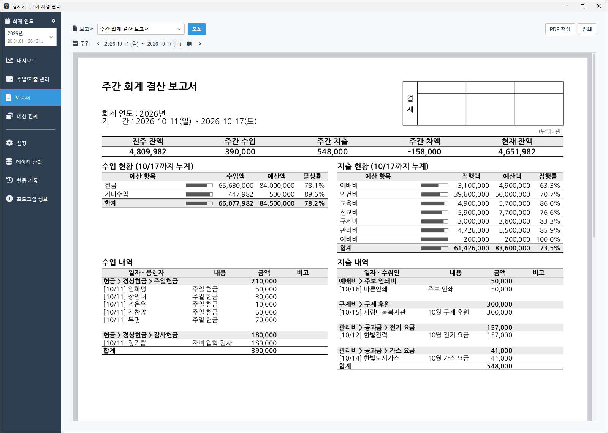
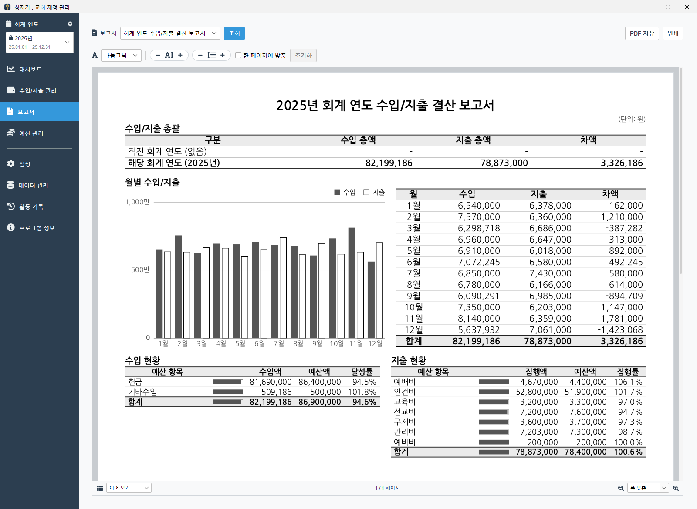
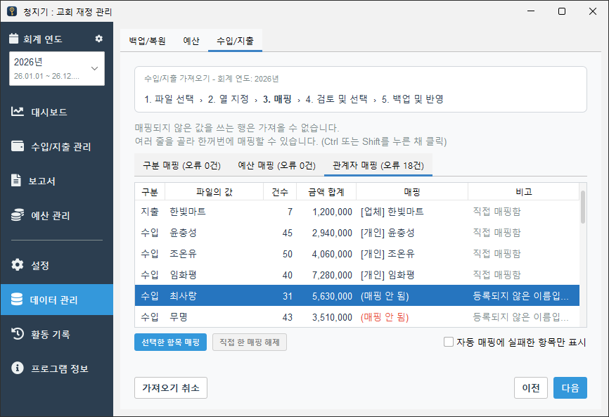

<p align="center">
  
</p>

<h1 align="center">청지기</h1>

<p align="center">작은 교회를 위한 재정 관리 프로그램</p>

<p align="center">
  <a href="https://github.com/typemild/church-steward/releases/latest">
    
  </a>
</p>

---

청지기는 교회의 수입(헌금)과 지출, 예산을 기록하고 주간·결산 보고서를 만드는 데스크톱 프로그램입니다.
인터넷 연결이나 서버 없이 PC 한 대에서 동작하며, 모든 데이터는 암호화되어 PC 안에만 저장됩니다.

<p align="center">
  
</p>

## 평생 무료

청지기는 **평생 무료**입니다. 사용료나 유료 기능이 없으며, 어느 교회든 자유롭게 내려받아 쓸 수 있습니다.

청지기는 오픈 소스 프로그램입니다. 프로그램의 설계도에 해당하는 소스 코드가 이곳에 모두 공개되어 있어서, 누구나 보고 고칠 수 있습니다([라이선스](#라이선스)).
그래서 혹시 제 신변에 문제(?)가 생겨도 다른 프로그래머가 이 소스 코드를 이어받아 유지보수할 수 있습니다.

## 주요 기능

- **수입/지출 관리**: 일자, 예산, 금액, 내용, 봉헌자/수취인을 기록하고 기간·예산·사람별로 조회하는 기능입니다. 봉헌자 이름은 자동 완성되며, 함께 헌금하는 가족은 그룹으로 한 번에 입력할 수 있습니다.
- **예산 관리**: 회계 연도마다 수입 예산과 지출 예산을 여러 단계(예: 관/항/목)로 구성하고, 예산 대비 실제 금액과 달성률·집행률을 확인할 수 있습니다.
- **회계 연도**: 이름과 기간을 자유롭게 정할 수 있습니다(예: 12월 1일 ~ 다음 해 11월 30일). 결산이 끝나면 마감해서 더 이상 바뀌지 않게 할 수도 있습니다.
- **보고서**: 주간 회계 결산 보고서, 수입/지출 예산안, 결산 보고서, 결산 세부 내역서를 조회하고 인쇄할 수 있습니다. 보고서를 PDF로 저장할 수도 있습니다.
- **대시보드**: 최근 수입/지출과 예산 대비 집행 현황을 한눈에 볼 수 있습니다.
- **여러 사용자와 활동 기록**: 관리자 계정 외에 일반 사용자 계정을 만들 수 있으며, 누가 언제 무엇을 바꿨는지 활동 기록에서 확인할 수 있습니다.
- **백업과 복원**: 전체 데이터를 백업하고, 다른 PC에서 복원할 수 있습니다.
- **엑셀 가져오기/내보내기**: 엑셀(xlsx, xls)이나 CSV로 정리해 둔 봉헌자/수취인, 예산, 수입/지출 내역을 가져오거나 내보내는 기능입니다.

자세한 동작은 [요구사항 명세서](docs/requirements.md)에 있습니다.

> [!NOTE]
> 청지기는 수입과 지출을 예산별로 기록하는 단식부기 방식입니다.
> 차변/대변, 계정과목, 재무상태표 같은 **복식부기 기능은 제공하지 않으며, 앞으로도 제공할 계획이 없습니다.**

## 화면

화면의 이름과 금액은 모두 예시로 만든 것입니다.

| 수입/지출 관리 | 수입 입력과 봉헌자 자동 완성 |
|:---:|:---:|
|  |  |

**예산 관리**: 수입 예산과 지출 예산을 여러 단계로 구성하고, 예산마다 실제 금액과 달성률·집행률을 함께 봅니다.

<p align="center">
  
</p>

| 주간 회계 결산 보고서 | 회계 연도 수입/지출 결산 보고서 |
|:---:|:---:|
|  |  |

**엑셀 가져오기**: 파일의 예산과 봉헌자/수취인 이름을 프로그램에 등록된 것과 연결한 뒤 한꺼번에 가져옵니다.

<p align="center">
  
</p>

## 다운로드

[Releases](https://github.com/typemild/church-steward/releases)에서 최신 버전을 내려받습니다.

| 운영체제 | 파일 | 필요한 것 |
|---|---|---|
| Windows 10/11 (64비트) | `ChurchSteward-<버전>-windows.zip` | 없음 (Java가 들어 있습니다) |
| macOS, 리눅스 등 | `church-steward-<버전>.jar` | [Java 25](https://adoptium.net/) 이상 |

macOS와 리눅스용 jar는 동작하도록 만들었지만, 주로 확인하는 환경은 Windows입니다.

## 설치와 실행

### Windows

1. zip 파일의 압축을 풉니다. `ChurchSteward` 폴더 하나가 나옵니다.
2. 이 폴더를 원하는 곳에 둡니다(예: C 드라이브 바로 아래의 `C:\ChurchSteward`). **데이터도 이 폴더 안에 저장됩니다.**
3. 폴더 안의 `ChurchSteward.exe`를 실행합니다. 바탕화면에서 실행하려면 `ChurchSteward.exe`의 바로 가기를 만들어 두세요.

> [!WARNING]
> 바탕화면, 문서 폴더처럼 **OneDrive와 동기화되는 폴더에는 두지 마세요.**
> 프로그램이 쓰고 있는 데이터베이스 파일을 동기화하면 파일이 잠기거나 손상될 수 있습니다.

처음 실행할 때 "Windows의 PC 보호" 창이 뜰 수 있습니다. 청지기는 코드 서명을 하지 않았기 때문입니다.
**추가 정보** → **실행**을 누르면 됩니다.

### macOS, 리눅스 등

Java 25 이상을 설치한 뒤, jar 파일을 둘 폴더를 정해 넣고 실행합니다.

```
java -jar church-steward-<버전>.jar
```

데이터는 jar 파일이 있는 폴더에 저장됩니다.

## 처음 실행할 때

처음 실행하면 **관리자 계정**을 만듭니다. 관리자의 ID는 "관리자"로 정해져 있고 비밀번호만 정합니다.
비밀번호는 15자 이상이어야 하며, 여러 단어를 이은 문장형 비밀번호를 권장합니다.

다른 PC에서 쓰던 데이터가 있으면 관리자 계정을 만드는 대신 **백업에서 복원**을 고릅니다.

> [!CAUTION]
> **비밀번호를 잊으면 되찾을 방법이 없습니다.**
> 데이터는 사용자의 비밀번호를 이용해 암호화되어 있어서, 개발자도 비밀번호 없이는 데이터를 열 수 없습니다.
> 일반 사용자의 비밀번호는 관리자가 새로 정해 줄 수 있지만, 관리자 비밀번호는 다시 정할 방법이 없습니다.
> 관리자 비밀번호는 종이에 적어 안전한 곳에 보관하세요.

## 데이터 보관과 백업

프로그램 폴더(`ChurchSteward.exe` 또는 jar가 있는 폴더) 안에 다음 파일이 생깁니다.

| 이름 | 내용 |
|---|---|
| `data/` | 암호화된 데이터베이스 |
| `application.yml` | 사용자별로 암호화된 데이터베이스 키, 프로그램 설정 |
| `logs/` | 문제가 생겼을 때 원인을 찾기 위한 기록 |

`data/`와 `application.yml`은 둘 다 있어야 데이터를 열 수 있습니다.

**정기적으로 백업하세요.** 관리자 계정으로 로그인해 **데이터 관리 → 백업/복원**에서 백업 파일(`.csbackup`)을 만들고, USB 메모리나 다른 PC처럼 이 PC 밖에 보관합니다.

- 백업 파일은 암호화되어 있으며, 복원할 때는 **백업한 시점의 관리자 비밀번호**가 필요합니다.
- 복원하면 현재 데이터를 백업 파일의 내용으로 바꿉니다. 복원 직전의 데이터는 `data/before-restore-<일시>/`에 따로 보관됩니다.

## 새 버전으로 바꾸기

다음 중 한 가지 방법을 씁니다.

- **백업과 복원(권장)**: 기존 버전에서 백업 파일을 만든 뒤, 새 버전을 다른 폴더에 풀어 실행하고 처음 화면에서 **백업에서 복원**을 고릅니다.
- **폴더 옮기기**: 기존 버전을 끈 뒤, 새 버전을 다른 폴더에 풀고 기존 폴더의 `data/`와 `application.yml`을 새 폴더로 복사합니다.

새 버전이 데이터 구조를 바꿔야 하면 첫 로그인 때 자동으로 바꿉니다. 바꾸기 전의 데이터베이스 파일은 `data/before-migrate-<일시>/`에 복사해 둡니다.
새 버전에서 만든 백업은 이전 버전에서 복원할 수 없습니다.

## 문제가 생겼을 때

오류 창에 나오는 로그 파일(`logs/app.log`)의 위치를 확인하고, [Issues](https://github.com/typemild/church-steward/issues)에 증상과 함께 알려 주세요.
로그를 첨부할 때는 교인의 이름 같은 개인 정보가 들어 있지 않은지 먼저 확인해 주세요.

## 개발에 참여하기

- [기여 안내](CONTRIBUTING.md): 개발 환경, 빌드와 테스트, 코드 규칙, 커밋 규칙, 릴리스 절차
- [요구사항 명세서](docs/requirements.md): 기능이 어떻게 동작해야 하는지
- [아키텍처](docs/architecture.md): 구조와 주요 설계 결정
- [UI 가이드라인](docs/ui-guideline.md): 화면을 만들 때 지킬 규칙

Java 25, Spring Boot 4, Spring Data JPA(Hibernate), H2(암호화 파일 데이터베이스), Swing(FlatLaf)으로 만들었습니다.

## 라이선스

[MIT License](LICENSE)로 배포합니다. [한국어 번역본](LICENSE-ko)은 참고용이며 법적 효력은 영문 원문에 있습니다.

보고서에 쓰는 나눔고딕 글꼴은 [SIL Open Font License](src/main/resources/fonts/nanumgothic/OFL.txt)를 따릅니다.
사용한 오픈소스 라이브러리의 라이선스는 프로그램의 **프로그램 정보** 화면에서 볼 수 있습니다.
