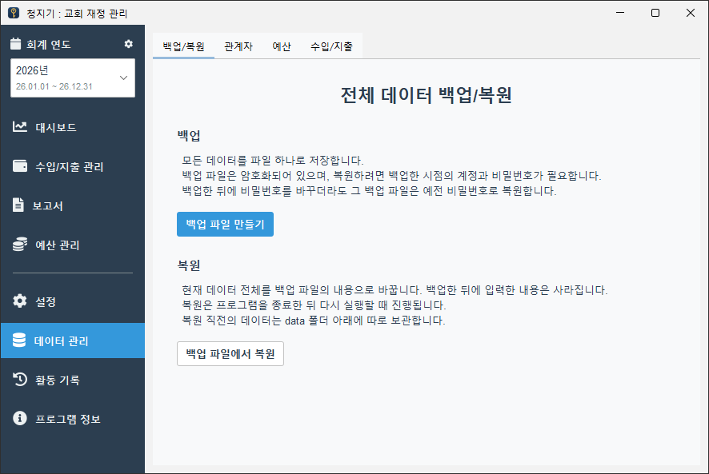
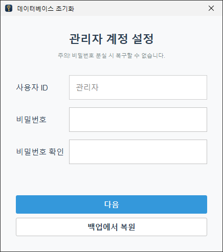
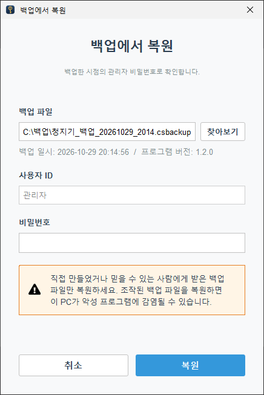

# 새 버전으로 업데이트하기

청지기는 자동 업데이트 기능을 제공하지 않습니다.
따라서 다소 불편하시겠지만, 새 버전으로 업데이트하시려면 본 문서의 절차를 직접 따라 해 주셔야 합니다.

본 문서에서는 청지기 프로그램을 `C:\ChurchSteward`에 설치해 사용하고 있는 것으로 가정합니다. 다른 곳에 설치하셨다면 그 위치로 바꿔서 읽어 주세요.

## 준비

### 1. 지금 쓰는 버전 확인

청지기의 **프로그램 정보** 메뉴에서 지금 버전을 확인합니다.
[Releases](https://github.com/typemild/church-steward/releases)의 최신 버전과 같으면 업데이트할 필요가 없습니다.

### 2. 관리자 비밀번호 확인

새 버전에서 데이터를 옮길 때 **관리자 비밀번호**가 필요합니다.
관리자 계정으로 로그인해 보고 비밀번호가 맞는지 확인합니다.

### 3. 백업 파일 만들기

1. 관리자 계정으로 로그인합니다.
2. **데이터 관리 → 백업/복원**에서 **백업 파일 만들기**를 누릅니다.
3. 저장할 위치를 고릅니다(예: 바탕화면). 파일 이름 끝은 `.csbackup`입니다.
4. "백업 파일을 저장했습니다." 창이 뜨면 완료입니다.

<p align="center">
  
</p>

> [!IMPORTANT]
> 백업 파일을 만든 뒤에는 **더 이상 내용을 입력하지 마세요.**
> 백업한 뒤에 입력한 내용은 새 버전으로 옮겨지지 않습니다.

### 4. 새 버전 내려받기

[Releases](https://github.com/typemild/church-steward/releases)에서 새 버전의 파일을 내려받습니다.

- Windows: `ChurchSteward-<버전>-windows.zip`
- macOS, 리눅스 등: `church-steward-<버전>.jar`

## Windows에서 업데이트하기

### 1. 청지기 끄기

청지기 창을 모두 닫습니다.

### 2. 기존 폴더 이름 바꾸기

`C:\ChurchSteward` 폴더의 이름을 `ChurchSteward-이전`으로 바꿉니다.
이 폴더는 문제가 생겼을 때 되돌아가기 위해 남겨 두는 것이므로 **지우지 마세요.**

### 3. 새 버전 두기

내려받은 zip 파일의 압축을 풀면 `ChurchSteward` 폴더가 나옵니다.
이 폴더를 기존 폴더가 있던 자리(`C:\ChurchSteward`)에 둡니다.

폴더의 위치가 예전과 같으므로 바탕화면의 바로 가기는 그대로 쓸 수 있습니다.

### 4. 백업에서 복원하기

1. 새 폴더의 `ChurchSteward.exe`(또는 바탕화면의 바로 가기)를 실행합니다.
2. "프로그램 최초 실행을 감지했습니다." 창이 뜨면 **확인**을 누릅니다.
3. "관리자 계정 설정" 화면에서 비밀번호를 입력하지 말고 **백업에서 복원**을 누릅니다.
4. **찾아보기**를 눌러 준비 단계에서 만든 백업 파일을 고릅니다. 백업 일시가 방금 백업한 시각인지 확인합니다.
5. 관리자 비밀번호를 입력하고 **복원**을 누릅니다.
6. "복원이 완료되었습니다." 창이 뜨면 **확인**을 누릅니다.
7. 로그인 화면이 나타나면 평소처럼 로그인합니다.

| 3. 관리자 계정 설정 화면 | 4~5. 백업에서 복원 창 |
|:---:|:---:|
|  |  |

일반 사용자 계정도 함께 옮겨지므로, 다른 사용자들도 쓰던 비밀번호로 로그인할 수 있습니다.

### 5. 확인하기

- **프로그램 정보**에서 버전이 새 버전으로 바뀌었는지 봅니다.
- 최근에 입력한 수입/지출 내역이 그대로 있는지 봅니다.

문제가 없으면 업데이트가 끝났습니다.
`ChurchSteward-이전` 폴더는 새 버전을 며칠 써 보고 문제가 없을 때 지우셔도 됩니다.

## macOS, 리눅스 등에서 업데이트하기

방법은 Windows와 같습니다. jar 파일이 있는 폴더에 데이터가 저장되므로, 새 jar를 새 폴더에 두고 백업에서 복원합니다.

1. 청지기를 끕니다.
2. 기존 jar가 있는 폴더의 이름을 바꿉니다(예: `ChurchSteward` → `ChurchSteward-이전`).
3. 원래 이름으로 새 폴더를 만들고 새 jar 파일을 넣습니다.
4. 새 jar를 실행합니다.
   ```
   java -jar church-steward-<버전>.jar
   ```
5. 이후는 Windows의 [4. 백업에서 복원하기](#4-백업에서-복원하기)부터와 같습니다.

## 문제가 생겼을 때 되돌리기

새 버전이 실행되지 않거나, 복원에 실패하거나, 쓰다가 문제가 생기면 이전 버전으로 되돌아갈 수 있습니다.
기존 폴더는 업데이트하는 동안 전혀 바뀌지 않았으므로, 폴더 이름만 원래대로 돌리면 됩니다.

1. 청지기를 끕니다.
2. 새 버전 폴더 `C:\ChurchSteward`의 이름을 `ChurchSteward-새버전`으로 바꿉니다.
3. `ChurchSteward-이전` 폴더의 이름을 `ChurchSteward`로 되돌립니다.
4. `ChurchSteward.exe`(또는 바탕화면의 바로 가기)를 실행해 평소처럼 로그인합니다.

되돌리기 전에 다음을 알아 두세요.

- 이전 버전은 **업데이트 전에 백업한 시점의 데이터**로 돌아갑니다. 새 버전에서 입력한 내용은 이전 버전에 없습니다. 이 내용은 [새 버전에서 입력한 내용 옮기기](#새-버전에서-입력한-내용-옮기기)로 옮겨 올 수 있습니다.
- **새 버전에서 만든 백업 파일은 이전 버전에서 복원할 수 없습니다.**
- 새 버전 폴더(`ChurchSteward-새버전`)는 문제의 원인을 찾을 때 필요하므로 바로 지우지 마세요.

되돌린 뒤에는 [Issues](https://github.com/typemild/church-steward/issues)에 어떤 문제가 있었는지 알려 주세요.
새 버전 폴더 안의 `logs/app.log` 파일을 함께 보내 주시면 원인을 찾는 데 도움이 됩니다.
로그를 첨부할 때는 교인의 이름 같은 개인 정보가 들어 있지 않은지 먼저 확인해 주세요.

## 새 버전에서 입력한 내용 옮기기

되돌리기 전에 새 버전에서 입력한 내용이 있다면, 새 버전에서 **내보내기**로 파일을 만든 뒤 이전 버전에서 **가져오기**로 옮길 수 있습니다.
내보내기와 가져오기는 관리자 계정으로 로그인해야 쓸 수 있습니다.

### 1. 새 버전에서 내보내기

되돌리기 전에, 새 버전에서 다음을 합니다.

1. **데이터 관리**에서 **관계자**, **예산**, **수입/지출** 탭을 차례로 엽니다.
2. 탭마다 **내보내기**를 눌러 파일로 저장합니다. 예산과 수입/지출은 새 버전에서 입력한 회계 연도를 골라 내보냅니다.
3. 저장한 파일은 폴더 밖(예: 바탕화면)에 둡니다.

### 2. 이전 버전에서 가져오기

[되돌리기](#문제가-생겼을-때-되돌리기)를 마친 뒤, 이전 버전에서 다음을 합니다.

1. 새 버전에서 회계 연도를 새로 추가했다면, **설정 → 회계 연도 관리**에서 같은 이름과 기간으로 먼저 추가합니다.
2. **데이터 관리**에서 **관계자 → 예산 → 수입/지출** 순서로 가져옵니다. 수입/지출을 가져오려면 봉헌자/수취인과 예산이 먼저 등록되어 있어야 하기 때문입니다.
3. 각 탭에서 **가져오기**를 누르고, 앞에서 내보낸 파일을 골라 화면의 안내를 따릅니다.
4. "검토 및 선택" 단계에서 **중복 의심**으로 표시된 행은 이미 이전 버전에 있는 내용입니다. 처음부터 선택에서 빠져 있으므로 그대로 두고 진행합니다.

이전 버전이 1.1.0 이하라면 **관계자** 탭이 없습니다. 이때는 새 버전에서 새로 등록한 봉헌자/수취인을 이전 버전에서 직접 등록한 뒤 수입/지출을 가져옵니다.

### 옮겨지지 않는 것

내보내기와 가져오기는 내용을 **추가**만 합니다. 다음은 옮겨지지 않으므로 이전 버전에서 직접 맞춰 주세요.

- 새 버전에서 **수정하거나 삭제한** 수입/지출 내역. 수정한 내역은 새 내역으로 추가되므로, 이전 버전에 남아 있는 수정 전 내역을 찾아 지웁니다.
- 예산의 이름이나 순서를 바꾸거나 예산을 삭제한 것. 이름을 바꾼 예산은 새 예산으로 추가되므로 이전 이름의 예산을 정리합니다. 금액을 바꾼 것은 가져오기에서 반영됩니다.
- 회계 연도의 마감, 사용자 계정과 비밀번호의 변경, 보고서 설정.
